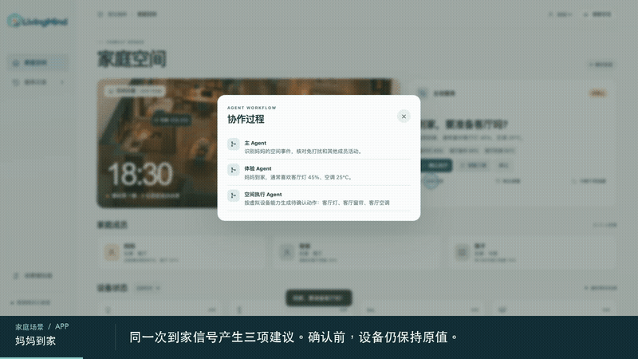
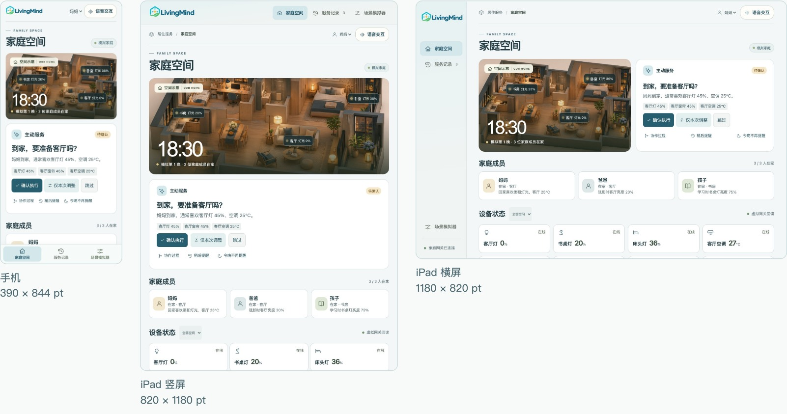

# LivingMind

**A proactive residential-service agent designed for the SpaceMind ecosystem.**

[中文](README.md) · [Watch the film](docs/media/family-evening.mp4) · [Run the app](#run-the-app) · [API and device contract](docs/family-api.md) · [Architecture and feature inventory](docs/family-architecture-review.md)

[](docs/media/family-evening.mp4)

Three people share a home. A parent wants to read, a child is studying, and another parent starts a movie. LivingMind proposes changes that account for each person, the room they are using, and what the devices last reported. Residents can revise a proposal for one evening, confirm it, or quiet suggestions.

## Watch a family evening

[](docs/media/family-evening.mp4)

The silent film alternates between recordings of the running app and illustrated explanations with excerpts from its source code. Chinese captions along the bottom describe each step. Room signals and all eight devices are simulated. The child’s request to study uses the app’s labeled example transcript. [Watch or download the MP4](docs/media/family-evening.mp4) · [Read the scene transcript](docs/family-film.md)

Watch what happens when a parent changes the arrival plan to set only the living-room light to 65%. Later, the movie plan limits audio to 18% while the child studies. A missing curtain reading stays unknown, even as other devices report success. The next evening’s arrival proposal returns to the usual 45% light level.

## Run the app

From the repository root, with Python 3.9 or later:

```sh
python3 backend/family_demo.py
```

Open the [local app](http://127.0.0.1:8765) and choose **场景模拟器 → 妈妈到家** (simulate the mother's arrival). The default household runs in memory with the Python standard library. Restarting the server restores its initial state. [Film and device gallery](http://127.0.0.1:8765/showcase/) · [Original Expo and backend setup](docs/classic-quickstart.md)

**Try two device models and save your progress.** This optional setup binds the desk lamp and study fan to two MIoT model specifications and stores household state and receipts in a local SQLite file. Both devices remain simulated.

```sh
python3 backend/family_demo.py --port 8766 \
  --state-db /tmp/livingmind-two-models/house.sqlite3 \
  --miot-profile backend/examples/family-miot-two-models.json
```

Open the [model demo](http://127.0.0.1:8766). From the initial state, choose **场景模拟器 → 孩子开始学习 → 确认执行** (start a study session and confirm). The receipts show **75% brightness** and **fan level 1**. Restart with the same command to resume. Two local server processes can share the same database and model profile. A second screen can read progress during a slow confirmation. After an interrupted execution, completed actions keep their receipts, the in-flight action is marked unknown, and remaining actions are skipped. Retrying the same confirmation returns its recorded result. Expand a device receipt to inspect its model, property address and response codes. [Receipt screenshot](docs/media/family-miot-receipts.png) · [Model profile](backend/examples/family-miot-two-models.json) · [Cross-process recovery checks](docs/family-validation.md)

## Phone and tablet

Screenshots show one viewport at the native display scale. The phone scrolls vertically and keeps its navigation accessible. Portrait iPad stacks the room and proposal, while landscape iPad places them side by side.



[Phone · 390 × 844](docs/media/phone.jpg) · [iPad portrait · 820 × 1180](docs/media/ipad-portrait.jpg) · [iPad landscape · 1180 × 820](docs/media/ipad-landscape.jpg)

## Engineering

| Layer | Behavior |
| --- | --- |
| Main Agent | Routes household events, coalesces duplicate signals, supersedes old proposals and respects quiet hours. |
| Experience Agent | Combines member preferences, shared-room activities and exceptions that expire the next evening. |
| Space Execution Agent | Filters targets against capabilities and current readings. Optional model-assisted wording edits are bounded by the pending proposal. |
| Consent and gateway | A resident confirms a particular revision. Each virtual device receives a separate command and observation. The timeline preserves partial failures. |
| Voice | Browser dictation, editable text and interruptible speech. Optional locally enrolled speaker comparison suggests a candidate for review. A supplied example transcript is explicitly labeled in the app. |

To trace the movie scene in code, follow `experience_targets` for the volume limit, `FamilyEvening.decide` for confirmation, and `decode_observation` for the comparison between a requested value and a device reading. [Household preferences and plans](backend/app/family/agents.py) · [Proposals and confirmation](backend/app/family/service.py) · [Gateway and device readings](backend/app/family/gateway.py)

Physical Xiaomi and SpaceMind connections and household microphone performance have yet to be validated. The legacy Expo/FastAPI service and offline home-energy experiment are available separately. [Family API](docs/family-api.md) · [Voice setup and experiment](docs/family-voice.md) · [Tests and film production](docs/family-validation.md) · [v1.0 release](docs/releases/v1.0.0.md)
