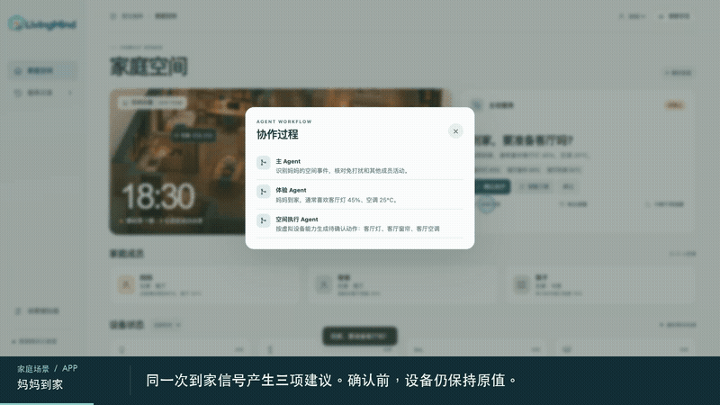
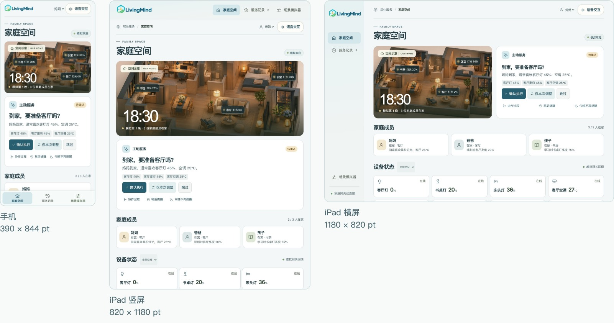
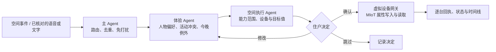

# LivingMind

**A proactive home agent for a family of three.** · 面向 SpaceMind 生态设计的主动居住服务 Agent。

[English](README.en.md)　·　[观看中文演示影片](docs/media/family-evening.mp4)　·　[运行模拟 App](#运行模拟-app)　·　[家庭服务接口](docs/family-api.md)

[](docs/media/family-evening.mp4)

妈妈回家后临时想看书，孩子正在学习，爸爸准备看电影。LivingMind 结合三个人的偏好、各自所在的房间和设备状态提出建议。住户可以修改单次计划、确认执行，或者让空间今晚保持安静。

## 观看演示

[](docs/media/family-evening.mp4)

**[播放或下载完整影片 · MP4](docs/media/family-evening.mp4)**　约 1 分钟，有中文旁白和画内字幕。影片使用浏览器实际运行并操作本仓库的 App。房屋封面是概念效果图，空间事件和八台设备的读数来自模拟器。影片中的语音输入示例使用标明来源的模拟转写。

| 当晚发生了什么 | 在 App 里可以核对什么 |
| --- | --- |
| 妈妈说「我今晚还要看书，客厅亮一点，卧室先别动」 | 三项到家建议收敛为一项。确认前设备读数不变，确认后只有客厅灯报告 65%。 |
| 孩子在书房学习，爸爸想看电视 | 书桌灯调到 75%，循环扇启动。观影建议将客厅音箱限制为 18%，书桌照明继续保持。 |
| 妈妈准备休息，卧室窗帘缺少回执 | 床头灯和音箱各自显示执行结果，窗帘保留上次读数并显示待核对。 |
| 进入下一晚，再次模拟妈妈到家 | 系统重新从妈妈通常的 45% 到家亮度规划，昨晚的临时例外到期。 |

[到家建议](docs/media/arrival.jpg)　·　[学习与观影协调](docs/media/coordination.jpg)　·　[逐台执行回执](docs/media/receipts.jpg)

## 运行模拟 App

在仓库根目录执行，使用 Python 3.9 或更高版本。

```sh
python3 backend/family_demo.py
```

打开 [本机演示](http://127.0.0.1:8765) 或[本机影片与设备预览](http://127.0.0.1:8765/showcase/)。在 App 中选择 **场景模拟器 → 妈妈到家**。默认版本仅依赖 Python 标准库，设备执行和规划均可离线复现。同一服务进程内的浏览器标签页共享一个家庭会话。可以重置演示，或选择「进入下一晚」观察临时偏好到期。原有 Expo 客户端与完整后端的启动方式见[工程运行指南](docs/classic-quickstart.md)。

## 手机与 iPad

同一条建议在手机上按阅读顺序纵向展开。iPad 竖屏上下排列空间和建议，横屏让两者并排。下图按真实视口的相对比例展示。点开各视图可查看独立单屏原图。



[手机 390 × 844](docs/media/phone.jpg)　·　[iPad 竖屏 820 × 1180](docs/media/ipad-portrait.jpg)　·　[iPad 横屏 1180 × 820](docs/media/ipad-landscape.jpg)

## 三个 Agent 怎样协作



家庭模拟的三项职责默认由确定性代码实现。可选模型解析额外的修改表达，模型候选值仍要经过当前方案、权限范围、数值范围和家庭约束检查。成员活动变化会撤下过期方案；修改产生新方案编号，确认只执行当前版本。原工程的 LangGraph、DeepSeek 休息规划与持久化虚拟网关可以独立运行。[家庭 API 与设备契约](docs/family-api.md) · [原有架构与运行方式](docs/classic-quickstart.md)

## 语音与米家接口

- **语音输入与朗读。** 支持浏览器中文语音识别、编辑转写、播报与打断。在有本地模型和已注册声音模板的配置下，可以上传 WAV 比对候选家庭成员。成员选择和设备确认各自独立。实际麦克风、远场噪声和家庭声纹识别率尚待实测。[语音代码与复现](docs/family-voice.md)
- **设备接口。** 客厅灯、书桌灯、床头灯、空调、两处窗帘、音箱和循环扇按能力建模。模拟器编码 MIoT 风格的设备属性，区分写入响应与设备回读。模拟设备编号用于本仓库；真实米家型号、账号授权和 SpaceMind 平台联调属于外部接入范围。[接口样例](docs/family-api.md) · [小米官方集成](https://github.com/XiaoMi/ha_xiaomi_home)
- **可复验的质量记录。** 包含家庭行为与并发回归、浏览器语音接口测试，以及真实浏览器完成的端到端操作和视口检查。[验证与录制方法](docs/family-validation.md)

## 项目资料

[家庭模拟前端](apps/family-demo/) · [家庭决策与网关](backend/app/family/) · [工程架构](docs/architecture.md) · [原版发布 v1.0.0](docs/releases/v1.0.0.md) · [独立能源仿真](simulation/home-energy/)
