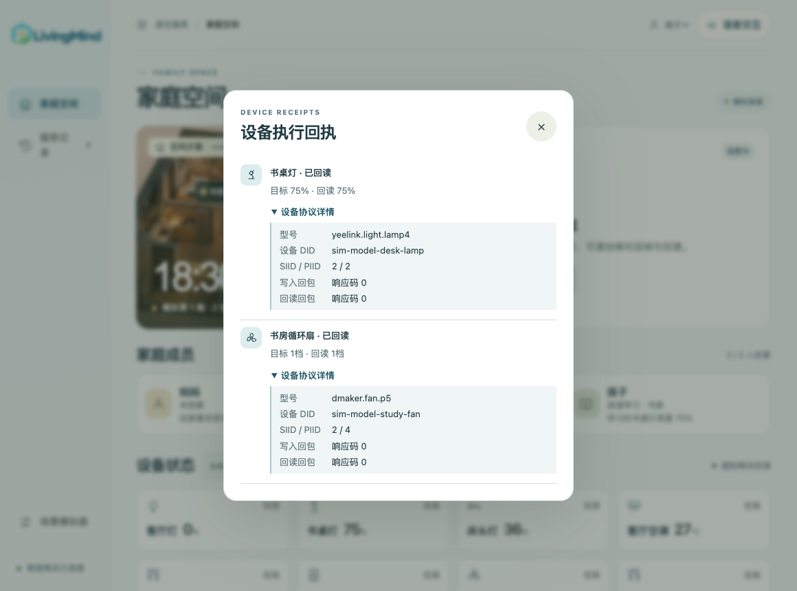

# 两个型号的离线 MIoT 属性样本

从仓库根目录启动带型号属性的家庭演示。

```sh
python3 backend/family_demo.py --miot-profile backend/examples/family-miot-two-models.json
```

触发「孩子学习」后，建议包含书桌灯 75% 和循环扇 1 档。确认后打开设备回执，展开“设备协议详情”直接检查两次操作的地址、写入结果和回读。初始亮度 20%、初始风速 2 档、两个以 `sim-model-` 开头的 DID 及后续读数均由本机模拟器提供。

| 家庭设备 | 型号和属性来源 | 演示绑定 | 同时导入的属性描述 |
| --- | --- | --- | --- |
| 书桌灯 | `yeelink.light.lamp4` · [MIoT 实例 JSON](https://miot-spec.org/miot-spec-v2/instance?type=urn:miot-spec-v2:device:light:0000A001:yeelink-lamp4:1) | 服务 2 / 属性 2，亮度 1–100%，步长 1，可读、写、通知 | 服务 1 / 属性 2，型号字符串，只读 |
| 书房循环扇 | `dmaker.fan.p5` · [MIoT 实例 JSON](https://miot-spec.org/miot-spec-v2/instance?type=urn:miot-spec-v2:device:fan:0000A005:dmaker-p5:1) | 服务 2 / 属性 4，档位 1、2、3、4，可读、写、通知 | 属性 5 是摆角枚举，属性 6 是连续风速，属性 7 只写 |

小米官方 Home Assistant 集成使用同一个 MIoT Spec V2 实例注册表。样本保留了用到的服务、属性、原始 URN 和枚举说明。运行演示只读取本地 JSON。属性的 `notify` 权限表示该型号声明支持通知。演示的确认状态来自虚拟传输层的一次独立回读。[小米官方集成中的规格解析器](https://github.com/XiaoMi/ha_xiaomi_home/blob/main/custom_components/xiaomi_home/miot/miot_spec.py)



## 修改离线输入

`format` 为 `miot-spec-v2`。在 `models` 中按型号提供 `source` 和注册表返回的 `instance` 对象，可保留需要检查的服务和属性。每条 `bindings` 通过 `deviceId` 选择家庭设备，通过 `model/siid/piid` 选择属性。型号、服务和属性实例号共同区分风扇的「档位」和「连续风速」。`did` 是这个虚拟设备实例的标识。`initial` 可指定模拟初值，数值须在所选属性范围或枚举内。

`GET /api/family/state` 的 `devices[].modelSpec` 返回来源、型号 URN 和导入的属性目录，`devices[].capability` 返回实际绑定的属性。原有的地址列表配置仍可用于只覆盖 DID/SIID/PIID。[双型号样本](family-miot-two-models.json) · [地址列表样本](family-miot-profile.json)
