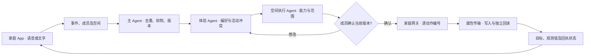

# LivingMind 代码架构评审与功能清单

**Engineering review · 2026-11-22**　[中文首页](../README.md) · [能运行的家庭演示](family-api.md) · [影片与源码分镜](family-film.md)

The family demo can generate a plan, revise it, obtain consent and verify each virtual device. These operations run through the browser and Python backend. Keep this architecture for the demo. Before adding a live bridge, make device execution recoverable and make the household state shareable across processes.

家庭版已经跑通从空间事件、主动建议、成员修改，到确认和逐台回读的完整链路，适合继续作为 SpaceMind 方向的主原型。下一阶段最值得投资的是家庭状态和动作回执的持久化，以及传输等待期间的可用性。本文以 GitHub 主分支 `61232a1` 为评审基线，并列入本次修改与回归结果。

## How the code runs · 两条执行路径

| 路径 | 入口与实际职责 | 验证边界 |
| --- | --- | --- |
| **Family demo · 家庭版** | 浏览器向标准库 HTTP 服务或 FastAPI 子应用提交事件。两种入口共用 `FamilyEvening`。主 Agent 管理事件与确认，体验规则生成目标，空间执行规则筛选设备动作，网关保存回执。[浏览器](../apps/family-demo/app.js) · [入口一](../backend/family_demo.py) · [入口二](../backend/app/family/api.py) · [状态机](../backend/app/family/service.py) | 一个进程维护一个家庭。首页、演示影片和下文的家庭指标均使用这条路径。 |
| **Classic service · 经典服务** | Expo 客户端使用独立的 FastAPI 路由。提供休息服务、偏好记忆、可选 LangGraph 编排、动作授权、SQL 账本和网关回执核对。[路由](../backend/app/api/routes.py) · [图运行时](../backend/app/graph/runtime.py) · [动作核对](../backend/app/harness/reconciliation.py) | 双 API、PostgreSQL 和独立 HTTP/SQLite 虚拟网关已经有集成测试。家庭版仍使用独立状态机。[双实例设计与验证](durable-gateway.md) |



## Feature inventory · 功能落地清单

“已实现”表示有可达的运行入口。“模拟验证”表示执行链已跑通，外部数据或设备由本地替身提供。“待接入”表示还需要实现相应的外部连接。

| 功能 | 状态 | 代码证据与实际效果 |
| --- | --- | --- |
| 三成员、三空间、八台设备 | 已实现 · 模拟环境 | 每位成员有活动、所在房间和演示偏好。设备有能力、取值范围与最近观测值。[家庭状态](../backend/app/family/service.py) · [设备目录](../backend/app/family/gateway.py) |
| 主动触发与抑制 | 已实现 · 模拟输入 | 到家、学习、观影、休息事件进入同一规划流程。处理来源、事件去重、短期合并、身份不明、免打扰和稍后提醒。真实空间传感器的持续采集待接入。[事件处理](../backend/app/family/service.py) · [家庭测试](../backend/tests/test_family_evening.py) |
| 三个 Agent 协作 | 已实现 · 规则驱动 | 主 Agent 编排，体验 Agent 依据成员偏好和其他人的活动给出目标，空间执行 Agent 校验可写性、数值范围和动作必要性。家庭演示的三个角色在一个进程运行。[规划与能力筛选](../backend/app/family/agents.py) |
| 多成员共享空间 | 已实现 | 孩子在客厅读书时保留共享灯光。在书房学习且父亲观影时，观影视听方案限制音量。当前冲突策略由代码枚举。[规则](../backend/app/family/agents.py) · [共享空间用例](../backend/tests/test_family_evening.py) |
| 方案修改、作用时段、确认与幂等 | 已实现 | 修改产生新编号。成员确认后才下发动作。“这次”和“今晚”分别生效。重试终态决定能查回原决定的结果。[决策处理](../backend/app/family/service.py) · [接口](family-api.md) |
| 语言模型辅助 | 已实现 · 可选 | 家庭版允许模型解析规则未识别的单设备修改，结果须通过设备范围、成员及方案版本检查。默认规则离线可运行。经典服务另有模型规划入口。[家庭编辑器](../backend/app/family/model_edit.py) · [经典规划器](../backend/app/services/planner.py) |
| 语音输入、朗读及打断 | 已实现 · 浏览器能力 | 中文识别、编辑转写、手动输入和可打断朗读都有代码。影片中的孩子使用标注的示例转写。最终结果和临时转写分开处理。[语音适配器](../apps/family-demo/voice.js) · [浏览器回归](../scripts/family-ui-regression.cjs) |
| 说话人比对 | 已实现 · 条件启用 | 本地录音模板与 ECAPA-TDNN 嵌入可产生候选人或未知。公开样本验证了比对流程，实际家庭远场准确率待测。候选人不直接获得设备控制权。[实现](../backend/app/family/speaker_model.py) · [实验记录](family-voice.md) |
| 手机、iPad 与证据展示 | 已实现 · 浏览器验证 | 固定视口和触控操作有回归。无声影片与源码导览可重放。原生 Expo 客户端走经典 API。[视口回归](../scripts/family-film/viewports.cjs) · [Expo 入口](../apps/mobile/App.tsx) |
| 家庭记忆与偏好 | 部分实现 | 家庭版有预置偏好、可过期的当晚例外及进程内记录。经典服务另有可编辑个人偏好。跨家庭版重启的偏好、例外及动作恢复待补。[家庭版](../backend/app/family/service.py) · [经典版](../backend/app/memory/service.py) |
| 工程验证与发布 | 已实现 | CI 包含家庭浏览器回归、移动端、经典 API 契约、三种后端配置及 Docker 端到端。家庭子 API 的独立 OpenAPI 仍缺少可生成完整客户端的字段定义。[CI](../.github/workflows/ci.yml) · [家庭 API](../backend/app/family/api.py) |
| 能源与节能 | 经典版与独立实验 | 经典服务提供能耗规则及节能模式。独立目录有离线家庭能源仿真与实验资料，家庭版的晚间建议没有调用该仿真模型。[能耗规则](../backend/app/energy/rules.py) · [离线实验](../simulation/home-energy/) |
| SpaceMind 平台对接 | 待接入 | 已有面向空间、人员偏好和主动服务的产品模型。仓库没有可验证的 SpaceMind 平台认证、事件订阅或官方设备下发实现。[家庭服务边界](family-api.md) |

## Xiaomi Home · 米家接入到哪一层

Working today: a logical device can be bound to an explicit MIoT property, written through an injected transport and checked against a separate observation. The included transport runs locally. Account login, discovery, model import and vendor network communication remain open.

今天可以运行的是**MIoT 属性级适配和本地模拟执行**。下面按实际调用链列出覆盖范围。小米官方集成另外实现了账号授权、设备列表、型号规范解析、云端及局域网通信，具体设备支持取决于型号与连接方式。[小米官方集成](https://github.com/XiaoMi/ha_xiaomi_home)

| 环节 | 当前状态 | 如何核对 |
| --- | --- | --- |
| 逻辑设备 → 属性地址 | **已实现** | 支持给八台虚拟设备中的指定设备配置 `did / siid / piid`。相同设备可通过不同属性地址区分。重复地址在启动时拒绝。[配置加载](../backend/app/family/profile.py) · [示例 JSON](../backend/examples/family-miot-profile.json) |
| 能力校验、属性写入与回读 | **已实现，模拟验证** | 建议生成、结构化编辑和网关读写共用同一套值域与步长规则。模拟温控器可接受 22.1°C，并在写入前拒绝偏离 0.1°C 步长的 22.15°C。传输对象分别提供 `write_property` 和 `read_property`。回包地址、结果码和读数独立核验，可区分确认、回读不符、未知、拒绝和离线。[网关实现](../backend/app/family/gateway.py) · [契约测试](../backend/tests/test_family_gateway_contract.py) |
| 超时、断线、重试 | **进程内已实现** | 读数丢失保留上次可靠观测。同一动作编号复用原回执。恢复在线后，虚拟网关刷新当前读数，历史未知结果保留。跨进程对账在经典网关另有实现。[家庭回归](../backend/tests/test_family_gateway_contract.py) · [经典网关](durable-gateway.md) |
| 真实设备发现与型号能力导入 | **待接入** | 当前从本地描述及手工地址配置加载。尚需把发现到的型号、服务、属性、权限、枚举和单位转换为家庭能力模型。 |
| 账号 OAuth、家庭选择与厂商通信 | **待接入** | 仓库没有小米登录、令牌刷新、设备列表同步或官方云／局域网客户端。替换传输对象是可用的接入点。 |
| 属性订阅、MIoT 事件与动作 | **待接入** | 当前覆盖属性读取和写入。能力描述中的 `notify` 是元数据。真实状态推送、事件 `eiid`、动作 `aiid` 及其参数映射均待实现。 |

**Offline check · 最短复验。** 在仓库根目录运行下列命令，打开终端显示的地址，触发“妈妈到家”并确认。在浏览器网络面板查看 `POST /api/family/decision` 的 `decisionResult.receipts`。客厅灯的请求会使用 `demo-lamp-01 / 3 / 7`，回读为 45%。这两个非默认编号可验证配置确实进入了实际执行链。[示例配置](../backend/examples/family-miot-profile.json)

```sh
python3 backend/family_demo.py --miot-profile backend/examples/family-miot-profile.json
```

## Findings and fixes · 本次修复

| 评审发现 | 修改与验收 |
| --- | --- |
| 妈妈的确认首次得到部分成功。后来孩子的动作成功，再重试妈妈的确认，旧接口只返回家庭最新的那批回执。 | 终态决定返回自己的 `decisionResult` 与 `decisionReplayed`。顶层状态继续反映当前家庭。浏览器分别展示重放回执与当前状态，跳过新建议后也会清除无关的回执入口。[后端回归](../backend/tests/test_family_evening.py) · [双标签页回归](../scripts/family-ui-regression.cjs) |
| 明确要求“今晚客厅灯 65%”，随后再次选择“仅保留客厅灯”，可能在当晚后续到家时回落到 45%。 | 再次收窄同一设备保留先前指定的数值。修改和最终确认仍使用不同版本编号。[决策实现与用例](../backend/tests/test_family_evening.py) |
| 语音识别中间结果先出现“确认”，完整语句可能是一句提问。早先按提交或回车可能过早执行。 | 临时文本等待识别结束或用户手动编辑。双标签页测试核对等待期间设备写入为零，后续明确确认才执行。[提交逻辑](../apps/family-demo/app.js) · [浏览器验证](../scripts/family-ui-regression.cjs) |
| 原家庭网关同时承担属性寻址、模拟设备和回包判定，难以换地址、替换传输或验证错误回包。 | 分出传输接口、可配置地址和公共回读规则。默认离线运行与注入适配器都走同一网关路径。只支持读写的适配器收到模拟故障控制请求时返回明确的 `409 SIMULATION_ONLY`。[属性网关](../backend/app/family/gateway.py) · [地址映射端到端测试](../backend/tests/test_family_profile.py) |

## Remaining work · 后续优先级

| 优先级 | 具体缺口与影响 | 建议的验收条件 |
| --- | --- | --- |
| **P1 · 家庭动作持久化** | 家庭会话、去重记录与动作回执目前存在内存中。服务重启会恢复初始数据，多个实例各自持有不同家庭。持续运行时时间线随历史增长，每次读取都会复制完整历史。[状态机](../backend/app/family/service.py) | 同一个家庭从第二个进程可见。执行后重启仍可按原动作 ID 读回结果，重试不重复写入。历史记录可分页。优先复用经典版账本与核对经验。 |
| **P1 · 慢设备下的家庭可用性** | 家庭状态锁内逐台同步调用网关。本轮用暂停回包的传输替身验证，确认在等待时，另一位成员读取家庭状态也会等待。默认内存设备速度快，接网络适配器后会放大此问题。[确认与下发](../backend/app/family/service.py) | 锁内记录已确认的方案版本与动作，锁外执行，结果按动作 ID 合并。让一台设备延迟回读时，另一终端仍能读取状态，同一动作始终只下发一次。 |
| **P2 · 家庭 API 契约及多屏同步** | 家庭 FastAPI 使用通用字典收请求，前端读取快照字段。两块持续亮屏的设备没有订阅状态变化，后端已保护过期确认，但闲置屏可能长时间显示旧建议。[家庭 API](../backend/app/family/api.py) · [页面同步](../apps/family-demo/app.js) | 给事件、决策、回执提供明确模型与版本，并为家庭子 API 做契约检查。用修订号配合增量拉取或 SSE 验证双屏在另一方确认后能自动更新。 |
| **P2 · 米家型号与事件覆盖** | 手工绑定能证明属性链路。面对不同型号的百分比、枚举、读写权限和事件语义，还需对照正式型号说明。[小米官方设备规范说明](https://github.com/XiaoMi/ha_xiaomi_home#mapping-relationship-between-miot-spec-v2-and-home-assistant-entity) | 先导入两份公开型号规范，在离线环境跑通能力映射、只读属性、枚举和通知。随后选择一条获得授权的桥接路径，再验收真实设备发现、写入、独立回读及断线重连。 |
| **P3 · 场景与语音评估** | 默认规则只覆盖定义好的活动。现有测试能验证程序行为，对是否打扰真实住户、远场识别效果和建议接受度仍缺观测证据。[场景用例](../backend/tests/test_family_evening.py) · [语音实验](family-voice.md) | 建立未参与规则编写的场景集，覆盖同室多人、活动先后互换和模糊转写，分别记录错误执行、错误提醒、需要澄清的比例。真实家庭试用另行取得参与者同意。 |

**Recommendation · 建议。** Keep the three roles in one deployable family service while the product is a simulator. Give the state store, typed events and device transport explicit contracts first. 真正接硬件前优先完成状态存储、事件契约和设备传输边界。这样每一项改动都能通过“谁确认了哪版方案、每台设备到底回了什么”来验收。

## Verification · 本轮验证记录

- **41 family tests.** 覆盖家庭状态机、可注入属性传输、地址配置和声纹接口响应。另有 5 项浏览器语音适配单测及双标签页 Chromium 操作回归。语音时序用可控识别回调验证。
- **Two HTTP entries.** 独立启动标准库服务，通过 HTTP 发送到家事件并确认，再通过 FastAPI 测试客户端重复同一流程。两个入口都从示例配置向 `demo-lamp-01 / 3 / 7` 写入 45 并读回 45。
- **Backend regression.** 本机默认配置的完整后端测试有 264 项通过、56 项按配置跳过，另有 34 个子测试通过。数据库和多实例组合由仓库 CI 分任务运行。[CI 配置](../.github/workflows/ci.yml)

已安装后端测试依赖时，在仓库根目录可以复跑以下检查。完整的浏览器依赖和录制方式见[验证指南](family-validation.md)。

```sh
(cd backend && python -m unittest discover -s tests -p 'test_family*.py')
node --test scripts/family_voice.test.cjs
node scripts/family-ui-regression.cjs
```
