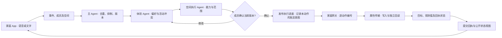

# LivingMind 代码架构评审与功能清单

**Engineering review · 2026-11-22**　[中文首页](../README.md) · [能运行的家庭演示](family-api.md) · [影片与源码分镜](family-film.md)

The family service now supports two operating modes. A quick demo owns its state in memory. Starting two local servers with the same SQLite state file lets them share proposals, preferences for tonight and device receipts across restarts. The devices in both modes are simulated.

住户确认方案后，如果有人在中途关闭服务，其他家人如何判断哪些动作已经完成？以 `61232a1` 为基线的评审先补齐了方案重试、数字偏好和属性回读。此后新增的共享存储将每台设备的发送意图与执行结果分别保存，恢复进程可以据此给出逐台答案。[家庭状态机](../backend/app/family/service.py) · [共享存储](../backend/app/family/storage.py)

## How the code runs · 两条执行路径

| 路径 | 入口与实际职责 | 验证边界 |
| --- | --- | --- |
| **Family demo · 家庭版** | 浏览器向标准库 HTTP 服务或 FastAPI 子应用提交事件。两种入口共用 `FamilyEvening`。主 Agent 管理事件与确认，体验规则生成目标，空间执行规则筛选设备动作，网关保存回执。[浏览器](../apps/family-demo/app.js) · [入口一](../backend/family_demo.py) · [入口二](../backend/app/family/api.py) · [状态机](../backend/app/family/service.py) | 默认每个进程运行一个临时家庭。通过 `--state-db` 或 `LIVINGMIND_FAMILY_STATE_DB`，同机多个服务进程可维护同一家庭。首页与演示影片使用家庭版。 |
| **Classic service · 经典服务** | Expo 客户端使用独立的 FastAPI 路由。提供休息服务、偏好记忆、可选 LangGraph 编排、动作授权、SQL 账本和网关回执核对。[路由](../backend/app/api/routes.py) · [图运行时](../backend/app/graph/runtime.py) · [动作核对](../backend/app/harness/reconciliation.py) | 双 API、PostgreSQL 和独立 HTTP/SQLite 虚拟网关已经有集成测试。家庭版仍使用独立状态机。[双实例设计与验证](durable-gateway.md) |



## Feature inventory · 功能落地清单

“已实现”表示有可达的运行入口。“模拟验证”表示执行链已跑通，外部数据或设备由本地替身提供。“待接入”表示还需要实现相应的外部连接。

| 功能 | 状态 | 代码证据与实际效果 |
| --- | --- | --- |
| 三成员、三空间、八台设备 | 已实现 · 模拟环境 | 每位成员有活动、所在房间和演示偏好。设备有能力、取值范围与最近观测值。[家庭状态](../backend/app/family/service.py) · [设备目录](../backend/app/family/gateway.py) |
| 主动触发与抑制 | 已实现 · 模拟输入 | 到家、学习、观影、休息事件进入同一规划流程。处理来源、事件去重、短期合并、身份不明、免打扰和稍后提醒。真实空间传感器的持续采集待接入。[事件处理](../backend/app/family/service.py) · [家庭测试](../backend/tests/test_family_evening.py) |
| 三个 Agent 协作 | 已实现 · 规则驱动 | 主 Agent 编排，体验 Agent 依据成员偏好和其他人的活动给出目标，空间执行 Agent 校验可写性、数值范围和动作必要性。家庭演示的三个角色在一个进程运行。[规划与能力筛选](../backend/app/family/agents.py) |
| 多成员共享空间 | 已实现 | 孩子在客厅读书时保留共享灯光。在书房学习且父亲观影时，观影视听方案限制音量。当前冲突策略由代码枚举。[规则](../backend/app/family/agents.py) · [共享空间用例](../backend/tests/test_family_evening.py) |
| 方案修改、作用时段、确认与幂等 | 已实现 | 修改产生新编号。成员确认后才下发动作。“这次”和“今晚”分别生效。重试终态决定能查回原决定的结果。[决策处理](../backend/app/family/service.py) · [接口](family-api.md) |
| 语言模型辅助 | 已实现 · 可选 | 家庭版允许模型解析规则未识别的单设备修改，结果须通过设备范围、成员及方案版本检查。默认规则离线可运行。经典服务另有模型规划入口。[家庭编辑器](../backend/app/family/model_edit.py) · [经典规划器](../backend/app/services/planner.py) |
| 语音输入、朗读及打断 | 已实现 · 浏览器能力 | 中文识别、编辑转写、手动输入和可打断朗读都有代码。影片中的孩子使用标注的示例转写。最终结果和临时转写分开处理。[语音适配器](../apps/family-demo/voice.js) · [浏览器回归](../scripts/family-ui-regression.cjs) |
| 说话人比对 | 已实现 · 条件启用 | 本地录音模板与 ECAPA-TDNN 嵌入可产生候选人或未知。公开样本验证了比对流程，实际家庭远场准确率待测。候选人不直接获得设备控制权。[实现](../backend/app/family/speaker_model.py) · [实验记录](family-voice.md) |
| 手机、iPad 与证据展示 | 已实现 · 浏览器验证 | 固定视口和触控操作有回归。无声影片与源码导览可重放。原生 Expo 客户端走经典 API。[视口回归](../scripts/family-film/viewports.cjs) · [Expo 入口](../apps/mobile/App.tsx) |
| 家庭记忆与偏好 | 部分实现 | 家庭版的长期偏好来自演示数据。当晚例外按成员、场景保存。启用共享数据库后，重启可找回这些例外、免打扰状态、待确认建议及动作记录。进入下一晚时临时设定到期。经典服务另有可编辑的长期偏好。[家庭版](../backend/app/family/service.py) · [经典版](../backend/app/memory/service.py) |
| 工程验证与发布 | 已实现 | CI 包含家庭浏览器回归、移动端、经典 API 契约、三种后端配置及 Docker 端到端。家庭子 API 的独立 OpenAPI 仍缺少可生成完整客户端的字段定义。[CI](../.github/workflows/ci.yml) · [家庭 API](../backend/app/family/api.py) |
| 能源与节能 | 经典版与独立实验 | 经典服务提供能耗规则及节能模式。独立目录有离线家庭能源仿真与实验资料，家庭版的晚间建议没有调用该仿真模型。[能耗规则](../backend/app/energy/rules.py) · [离线实验](../simulation/home-energy/) |
| SpaceMind 平台对接 | 待接入 | 已有面向空间、人员偏好和主动服务的产品模型。仓库没有可验证的 SpaceMind 平台认证、事件订阅或官方设备下发实现。[家庭服务边界](family-api.md) |

## Shared household · 多进程、多屏与中断恢复

A slow device may hold the household’s writer lease, while another screen reads the latest committed progress. The family service keeps commands in order and serves state reads independently.

以三项到家动作为例。确认请求先校验当前成员和建议编号，再为每项动作记录发送意图、调用网关、保存回执。写入与恢复同一时间只有一个本机进程负责。共享模式用独立 SQLite 文件持有写者锁，每个动作的检查点与公开视图提交到状态数据库。设备等待期间，其他请求仍能读取已提交的读数、已完成动作数和总动作数。并发确认等待写者完成，再按原建议编号取回决定。[执行与视图发布](../backend/app/family/service.py) · [写者锁与公开视图](../backend/app/family/storage.py)

假设客厅灯已回读，窗帘刚下发，空调还在队列中，此时终止写入进程。接手者取得写者锁后保留灯的回执，将窗帘标为 `unknown` 并令旧读数失去新鲜度，将未发送的空调标为 `skipped`。重试原确认会取得这三个结果。其他标签页保持前台、关闭对话框时，约每 2.5 秒拉取一次状态；编辑框保留打开时的建议版本，提交旧版本会触发重新核对。[进程终止回归](../backend/tests/test_family_storage.py) · [慢回读与重试](../backend/tests/test_family_execution.py) · [前台刷新](../apps/family-demo/app.js)

## Xiaomi Home · 米家接入到哪一层

The included offline profiles cover hand-bound addresses and property definitions from two published product models. Device discovery, account authorization and communication with a vendor gateway remain external integration work.

仓库附有带来源的型号规范节选。离线导入器可将台灯 `yeelink.light.lamp4` 的亮度，以及风扇 `dmaker.fan.p5` 的风速档位，绑定到书房的虚拟设备。运行时可以核对属性地址、单位、读写权限和枚举范围。真实住户账号及设备发现由后续桥接适配器承担。[两种型号与原始规范出处](../backend/examples/family-miot-two-models.json) · [规范导入器](../backend/app/family/miot_spec.py)

| 环节 | 当前状态 | 如何核对 |
| --- | --- | --- |
| 逻辑设备 → 属性地址 | **已实现** | 支持给八台虚拟设备中的指定设备配置 `did / siid / piid`。相同设备可通过不同属性地址区分。重复地址在启动时拒绝。[配置加载](../backend/app/family/profile.py) · [示例 JSON](../backend/examples/family-miot-profile.json) |
| 能力校验、属性写入与回读 | **已实现，模拟验证** | 建议生成、结构化编辑和网关读写共用同一套值域与步长规则。模拟温控器可接受 22.1°C，并在写入前拒绝偏离 0.1°C 步长的 22.15°C。传输对象分别提供 `write_property` 和 `read_property`。回包地址、结果码和读数独立核验，可区分确认、回读不符、未知、拒绝和离线。[网关实现](../backend/app/family/gateway.py) · [契约测试](../backend/tests/test_family_gateway_contract.py) |
| 超时、断线、重试 | **模拟验证，可持久化** | 回读缺失时保留上次观测与未知标记。共享模式可在同机重启后检索原决定和分设备回执。恢复在线时更新当前设备读数，历史未知结果保留。[家庭回归](../backend/tests/test_family_gateway_contract.py) · [经典网关](durable-gateway.md) |
| 型号属性导入 | **已实现，两种型号离线验证** | 从本地规范中的服务和属性提取访问权限、枚举、步长和单位。设备在用户家庭里的真实身份与地址仍需外部发现。[型号读取与绑定](../backend/app/family/miot_spec.py) · [台灯与风扇样例](../backend/examples/family-miot-two-models.json) |
| 账号 OAuth、家庭选择与厂商通信 | **待接入** | 仓库没有小米登录、令牌刷新、设备列表同步或官方云／局域网客户端。替换传输对象是可用的接入点。 |
| 属性订阅、MIoT 事件与动作 | **待接入** | 当前覆盖属性读取和写入。能力描述中的 `notify` 是元数据。真实状态推送、事件 `eiid`、动作 `aiid` 及其参数映射均待实现。 |

**Offline check · 最短复验。** 在仓库根目录运行下列命令，打开终端显示的地址，触发“妈妈到家”并确认。在浏览器网络面板查看 `POST /api/family/decision` 的 `decisionResult.receipts`。客厅灯的请求会使用 `demo-lamp-01 / 3 / 7`，回读为 45%。这两个非默认编号可验证配置确实进入了实际执行链。[示例配置](../backend/examples/family-miot-profile.json)

```sh
python3 backend/family_demo.py --miot-profile backend/examples/family-miot-profile.json
```

要在同一台电脑的两个端口复验共享家庭，可在两个终端分别启动下列进程。两者指向同一状态文件、同一份型号配置。触发孩子学习并确认后，两屏可以检索同一批书桌灯和循环扇回执。第二晚仍可使用这份状态文件。[双进程用例](../backend/tests/test_family_storage.py) · [离线型号映射用例](../backend/tests/test_family_miot_spec.py)

```sh
python3 backend/family_demo.py --port 8765 --state-db /tmp/livingmind-review/house.sqlite3 --miot-profile backend/examples/family-miot-two-models.json
python3 backend/family_demo.py --port 8766 --state-db /tmp/livingmind-review/house.sqlite3 --miot-profile backend/examples/family-miot-two-models.json
```

## Findings and fixes · 本次修复

| 评审发现 | 修改与验收 |
| --- | --- |
| 妈妈的确认首次得到部分成功。后来孩子的动作成功，再重试妈妈的确认，旧接口只返回家庭最新的那批回执。 | 终态决定返回自己的 `decisionResult` 与 `decisionReplayed`。顶层状态继续反映当前家庭。浏览器分别展示重放回执与当前状态，跳过新建议后也会清除无关的回执入口。[后端回归](../backend/tests/test_family_evening.py) · [双标签页回归](../scripts/family-ui-regression.cjs) |
| 明确要求“今晚客厅灯 65%”，随后再次选择“仅保留客厅灯”，可能在当晚后续到家时回落到 45%。 | 再次收窄同一设备保留先前指定的数值。修改和最终确认仍使用不同版本编号。[决策实现与用例](../backend/tests/test_family_evening.py) |
| 语音识别中间结果先出现“确认”，完整语句可能是一句提问。早先按提交或回车可能过早执行。 | 临时文本等待识别结束或用户手动编辑。双标签页测试核对等待期间设备写入为零，后续明确确认才执行。[提交逻辑](../apps/family-demo/app.js) · [浏览器验证](../scripts/family-ui-regression.cjs) |
| 原家庭网关同时承担属性寻址、模拟设备和回包判定，难以换地址、替换传输或验证错误回包。 | 分出传输接口、可配置地址和公共回读规则。默认离线运行与注入适配器都走同一网关路径。只支持读写的适配器收到模拟故障控制请求时返回明确的 `409 SIMULATION_ONLY`。[属性网关](../backend/app/family/gateway.py) · [地址映射端到端测试](../backend/tests/test_family_profile.py) |

## Remaining work · 后续优先级

| 优先级 | 当前边界 | 验收方式 |
| --- | --- | --- |
| P1 · 真实桥接与跨主机协调 | SQLite 共享模式面向同一台机器上的读写进程。接入真实网关和跨主机部署，需要明确谁拥有设备写权限、故障后如何查询原回执，以及授权的生命周期。 | 先在授权环境选一台灯，验证发现、能力读取、写入及独立回读。断开写者后，验证另一进程能查询不确定动作。多主机场景单独验证所有权切换。 |
| P2 · 历史数据增长 | 事件索引、活动记录、回执和决定随运行积累。每步检查点都序列化家庭状态与公开视图。 | 以一个月的事件量回放，记录数据库大小、确认耗时与快照体积，再制定分页、归档和去重保留期。保留仍可合法重试的原决定及其回执。 |
| P2 · 推送及接口契约 | 可见标签页已自动拉取变化。更快的跨终端通知、MIoT 属性推送与家庭 API 的字段级契约仍待建设。`notify` 表示型号支持通知的能力。 | 增加可恢复的订阅游标，验证断线后补齐状态、事件去重和草稿保护。通过契约用例核对旧客户端能读取新增字段。 |
| P3 · 场景与语音评估 | 当前证据来自模拟家庭、浏览器交互与公开语音样本。 | 用未参与规则编写的场景测试多人活动先后顺序和模糊请求。经参与者同意，记录真实使用中的误提醒、接受率及远场语音澄清率。 |

## Verification · 验证记录

测试让第二台设备延迟返回，同时从另一请求读到三项动作已完成一项。真实子进程测试则在第二条命令送出后终止写者，确认恢复时仍只发出原先两条命令。另一个用例运行两个独立 HTTP 服务，通过同一数据库在重启后重放先前决定。浏览器回归覆盖前台双屏同步、执行中快照和编辑草稿保护。两种型号的 6 项专项回归通过。在手机上展开协议详情可直接核对型号、地址及写入／回读响应码。[双型号回执实录](media/family-miot-receipts.png)。[执行进度测试](../backend/tests/test_family_execution.py) · [跨进程测试](../backend/tests/test_family_storage.py) · [浏览器回归](../scripts/family-ui-regression.cjs) · [属性传输测试](../backend/tests/test_family_gateway_contract.py)

已安装后端测试依赖时，在仓库根目录可以复跑以下检查。完整的浏览器依赖和录制方式见[验证指南](family-validation.md)。

```sh
(cd backend && python -m unittest discover -s tests -p 'test_family*.py')
node --test scripts/family_voice.test.cjs
node scripts/family-ui-regression.cjs
```
