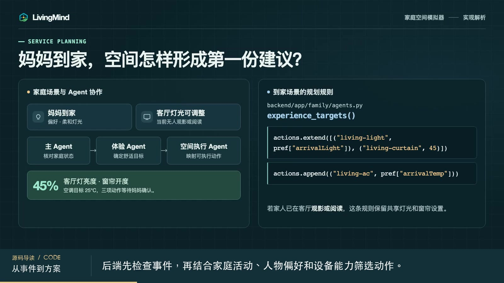

# 一家三口的晚间空间服务

妈妈到家时，系统建议打开客厅灯、调整窗帘和空调。她只想留一盏灯读书。跟着这盏灯，可以看到系统如何生成建议、等待用户确认，再核对设备返回的读数。[观看无声影片](media/family-evening.mp4)

画面里的操作来自本地运行的浏览器 App，每个请求都经过 Python 后端。人物偏好、到家信号、三个房间和八台设备采用演示数据。片中三段源码图解对应下方三个实现入口。



## 分镜文字稿

以下为各段开始的约略时间。所有百分比和温度都来自影片这次模拟。

| 时间 | 分镜 | 可以在画面中核对的内容 |
|---|---|---|
| 00:00 | 家庭空间 | 妈妈、爸爸、孩子共用客厅、书房和卧室。界面显示当前成员与设备状态。 |
| 00:05 | 妈妈到家 | 模拟器发出到家信号，App 提出客厅灯 45%、窗帘开度 45%、空调 25°C 三项建议。此时客厅灯仍是初始的 0%。 |
| 00:11 | 从事件到方案 | 源码图解跟踪一次请求，从事件去重、检查免打扰，走到读取成员偏好、筛选设备动作。 |
| 00:22 | 只改今晚 | 妈妈输入“我今晚还要看书，客厅亮一点，卧室先别动”。修改后的建议只保留客厅灯 65%，等待确认。 |
| 00:28 | 谁可以确认 | 源码图解并列展示修改与确认两条分支。本次确认必须携带新编号和妈妈的成员标识。 |
| 00:39 | 客厅灯回读 | 妈妈确认，虚拟网关回报客厅灯 65%。客厅空调仍是 27°C，窗帘开度仍是 80%。 |
| 00:44 | 孩子学习 | 选择孩子，用示例转写提交学习需求。确认后书桌灯变为 75%，书房循环扇开启一档。 |
| 00:50 | 爸爸观影 | 孩子仍在学习。观影方案将客厅灯调至 20%，把平时的 35% 音量限制在 18%，同时保留书桌灯 75%。 |
| 00:55 | 卧室窗帘 | 在模拟器中给卧室窗帘设定“回读未知”，随后触发妈妈的休息事件。 |
| 01:00 | 逐台核对 | 确认后，床头灯回读为 8%，客厅音量降至 12%。卧室窗帘的目标是关闭，结果显示待核对。 |
| 01:05 | 回执如何判定 | 源码图解并排显示同一房间里两种执行结果。系统分别核对写入应答和返回读数，窗帘保留未知状态。 |
| 01:16 | 次日晚间 | 进入下一晚，昨晚的临时设置到期。妈妈再次到家，客厅灯的**建议值**恢复为常用的 45%，还需重新确认。 |

拍摄脚本通过浏览器控件提交需求、修改方案、确认并查看回执。在它等待响应的地方可以直接找到对应的数值断言。[分镜与字幕](../scripts/family-film/story.json) · [实际操控与录制脚本](../scripts/family-film/capture.cjs)

## 三段源码导览

### 1. 为什么建议开灯

浏览器的 `eventAction` 生成事件编号，经 `fetchHousehold` 向 `POST /api/family/events` 发送到家事件、成员和事件来源。本地演示服务的 `Handler.family_request` 解析 JSON，将请求交给 `FamilyEvening.dispatch`。原 FastAPI 服务也在 `/api/family` 挂载同一套模拟逻辑。[浏览器入口](../apps/family-demo/app.js) · [本地演示 HTTP 服务](../backend/family_demo.py) · [FastAPI 挂载入口](../backend/app/main.py)

主 Agent 的 `event` 检查身份、重复信号和免打扰，再进入 `plan`。体验 Agent 的 `experience_targets` 结合母亲的偏好与其他人的活动提出目标。空间执行 Agent 的 `capability_actions` 检查设备可写属性、数值范围、步长和当前读数。这个家庭场景使用确定性规则，三个角色的结果可在建议轨迹中查看。[服务编排](../backend/app/family/service.py) · [体验规划与设备能力筛选](../backend/app/family/agents.py)

### 2. 为什么修改后还要再确认

浏览器先带着原建议编号请求 `edit`，后端缩小动作范围，返回一份新编号的建议。影片中的“亮一点”依据初始读数 0% 得出 65%。如果灯已经有 80% 亮度，同一句话会建议 90%。用户按“确认执行”后，浏览器发送当前成员、新编号及 `decision: "confirm"`。后端 `decide` 核对两者才向网关提交动作。若选择“今晚”，此次确认也保存该成员在这个场景下的当晚例外，次日自动清除。[编辑与确认逻辑](../backend/app/family/service.py) · [家庭接口和作用时段](family-api.md)

### 3. 为什么窗帘显示“待核对”

空间执行层为每个设备动作生成独立编号。虚拟网关的 `property_packet` 把设备和目标编码为 `did`、`siid`、`piid`、`value`。`decode_observation` 再比较地址、写入应答和回读值。片中窗帘的写入应答为 `code: 0`，回读缺失，因此对应 `status: "unknown"`、`observed: null`。床头灯返回 8%，有自己的成功回执。App 的 `receipts` 把两台设备分行展示。[网关与回读判定](../backend/app/family/gateway.py) · [App 的逐台回执视图](../apps/family-demo/app.js)

## 自己验证一个镜头

在仓库根目录运行下列命令，打开终端输出的本机地址，重置演示家庭。触发“妈妈到家”，在确认前拍下设备读数。输入片中的读书要求，检查预览是否只剩一盏客厅灯。再确认并核对该灯的观测值以及空调和窗帘的原值。

```sh
python3 backend/family_demo.py
```

也可以直接运行只覆盖家庭模拟的自动化检查。其中 `test_arrival_plans_without_writing` 比较确认前后的快照，`test_partial_failures_preserve_per_device_receipts` 检查成功、离线和缺失读数能否分别保留。[家庭模拟回归用例](../backend/tests/test_family_evening.py)

```sh
cd backend
python3 -B -m unittest discover -s tests -p test_family_evening.py -v
```
